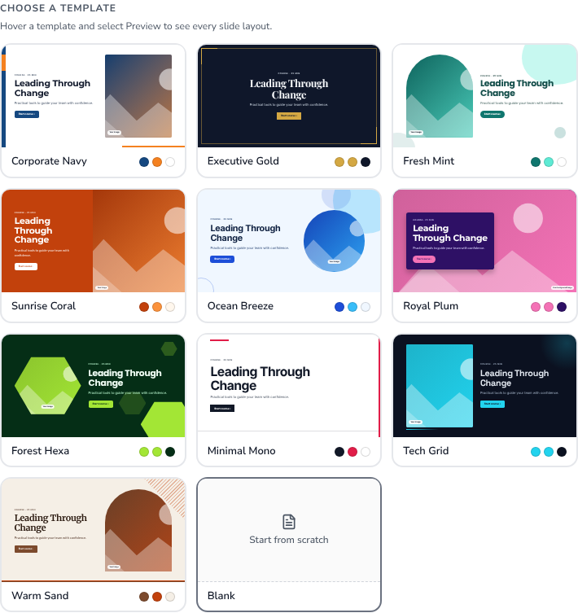
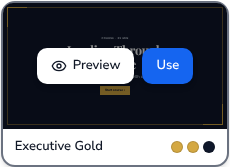

# Course Slide Templates — Design Spec (v1)

Handoff for building the 10 course templates, the template picker and the Preview popup.

**Where to see it**
- Live prototype: *Create Course → Step 1 → Template Selection & Branding* (turn off "Let AI choose"), and *Editor → Template* button.
- Storybook: **Slides / Templates** → `Gallery`, `PreviewPopup`, `AllTemplatesAllLayouts` (all 100 slides).
- Reference images: this folder (`<template>.png` = all 10 layouts of one template).
- Source of truth for every value below: `src/app/components/templates/courseTemplates.ts` (tokens) and `TemplateSlide.css` (layout + motifs).

---

## 1. Canvas and scaling

| Rule | Value |
|---|---|
| Design canvas | **1280 × 720** (16:9) |
| Unit | `cqw` (container query width). **1cqw = 12.8px** on the 1280 canvas |
| Why | The same slide renders as a 200px thumbnail, a 720px preview and a full-screen player with identical proportions. Never use fixed px inside a slide. |
| Safe area | Padding **5.5cqw top/bottom (70px), 7cqw left/right (90px)** |
| Layers | `bg colour` → `motif` (decorative, z 0) → `content` (z 1) |

### Type scale (px on 1280 canvas)

| Token | cqw | px | Weight | Font |
|---|---|---|---|---|
| Cover title (H1) | 4.8 | 61 | 700 | heading |
| Slide title (H2) | 3.2 | 41 | 700 | heading |
| Question (H3) | 2.4 | 31 | 700 | heading |
| Quote | 3.6 | 46 | 600 | heading |
| Lead / subtitle | 1.8 | 23 | 400 | body, `muted` colour |
| Body | 1.55 | 20 | 400 | body, line-height 1.55 |
| Small (step text, captions) | 1.35 | 17 | 400 | body, `muted` |
| Eyebrow | 1.15 | 15 | 700 | body, UPPERCASE, letter-spacing 0.14em, `muted` |
| Button | 1.35 | 17 | 700 | body |

Accent rule under titles: **6cqw × 0.45cqw** (77 × 6px), `primary`, margin 1.8cqw above.

---

## 2. Template tokens

Every template defines 7 colours, 2 fonts, a radius, a button style, a **motif** and a **cover layout**.

| Colour token | Used for |
|---|---|
| `bg` | Slide background |
| `surface` | Cards, panels, answer options |
| `primary` | Title rule, bullets, number badges, buttons, selected states |
| `onPrimary` | Text/icons on `primary` |
| `accent` | **Decoration only** (motif shapes). Never body text. |
| `text` | Headings and body |
| `muted` | Eyebrows, captions, secondary text |

| # | Template | Mode | bg | surface | primary | onPrimary | accent | text | muted | Heading / Body font | Radius | Buttons | Motif | Cover |
|---|---|---|---|---|---|---|---|---|---|---|---|---|---|---|
| 1 | **Corporate Navy** | light | `#FFFFFF` | `#F1F5F9` | `#154880` | `#FFFFFF` | `#F48120` | `#0F172A` | `#475569` | Montserrat / Inter | 10px | rounded | side-band | image-right, rect |
| 2 | **Executive Gold** | dark | `#0F172A` | `#1E293B` | `#D4A843` | `#0F172A` | `#D4A843` | `#F8FAFC` | `#CBD5E1` | Playfair Display / Inter | 4px | square | gold-frame | centered, no image |
| 3 | **Fresh Mint** | light | `#FFFFFF` | `#F0FDFA` | `#0F766E` | `#FFFFFF` | `#5EEAD4` | `#134E4A` | `#3F5F5B` | Poppins / Poppins | 18px | pill | soft-blobs | image-left, arch |
| 4 | **Sunrise Coral** | light | `#FFF7ED` | `#FFFFFF` | `#C2410C` | `#FFFFFF` | `#FB923C` | `#431407` | `#7C2D12` | Montserrat / Lato | 12px | rounded | diagonal | split colour |
| 5 | **Ocean Breeze** | light | `#F0F7FF` | `#FFFFFF` | `#1D4ED8` | `#FFFFFF` | `#38BDF8` | `#0C1E3E` | `#334E7A` | Inter / Inter | 14px | rounded | circles | image-right, circle |
| 6 | **Royal Plum** | dark | `#2E1065` | `#3B1C78` | `#F472B6` | `#2E1065` | `#F472B6` | `#FFFFFF` | `#DDD6FE` | Montserrat / Lato | 16px | pill | arc | full-bleed photo |
| 7 | **Forest Hexa** | dark | `#052E16` | `#14532D` | `#A3E635` | `#052E16` | `#A3E635` | `#F0FDF4` | `#BBF7D0` | Poppins / Inter | 10px | rounded | hexagons | image-left, hexagon |
| 8 | **Minimal Mono** | light | `#FFFFFF` | `#F5F5F5` | `#111827` | `#FFFFFF` | `#E11D48` | `#111827` | `#4B5563` | Inter / Inter | 0 | square | red-rule | type only |
| 9 | **Tech Grid** | dark | `#0B1120` | `#111C33` | `#22D3EE` | `#0B1120` | `#22D3EE` | `#E2E8F0` | `#A5B4C8` | Space Grotesk / Inter | 8px | rounded | dot-grid | image-left, rect |
| 10 | **Warm Sand** | light | `#F5EFE6` | `#FFFFFF` | `#7C4A2D` | `#FFFFFF` | `#C2410C` | `#2B1A10` | `#5C4033` | Merriweather / Lato | 6px | rounded | paper | image-right, arch |

Button radius: `rounded` = template radius, `pill` = 999px, `square` = 0.

### Contrast (WCAG 2.2 AA) — verified

All pairs pass 4.5:1 for every template (lowest: Sunrise Coral `onPrimary/primary` 5.2:1, Fresh Mint 5.5:1).
Checked: text/bg, muted/bg, text/surface, muted/surface, onPrimary/primary, primary/bg.
Quiz feedback chip: `#14532D` on `#DCFCE7` (8.3:1) in every template.
**Do not** put text on `accent`; do not use `accent` for thin rules that carry meaning.

---

## 3. Slide layouts (10 per template)

Same order in the Preview popup. Measurements in cqw (px @1280).

| # | Layout | Composition |
|---|---|---|
| 1 | **Title** (cover) | Varies per template — see §4. Eyebrow "Course · 25 min", H1, lead, primary button "Start course ›". |
| 2 | **Section divider** | Big section number (13cqw / 166px, weight 800, `primary`) + 4cqw gap + eyebrow, H1 (max 50cqw), rule, lead. Strong motif. |
| 3 | **Title + Text** | Text column max **64%** width. Eyebrow, H2, rule, 1–2 paragraphs (1.2cqw gap). |
| 4 | **Bullet points** | H2 then list, max 80% width, 1.4cqw row gap. Marker: 1cqw square in `primary`, shaped by button style (pill → circle, square → square). Bold lead-in words. |
| 5 | **Image + Text** | 2 columns `1fr / 1.1fr`, gap 4.5cqw. Image aspect 4:3.4 using the template's image shape. Right: eyebrow, H2, rule, body, tip chip. |
| 6 | **Comparison** | 2 equal cards, gap 2.4cqw. Card = `surface`, radius, 1px border text@12%. Left header solid `primary`/`onPrimary`; right header plain with 0.25cqw `primary` underline. Rows 0.9cqw × 1.8cqw padding, 1px dividers. |
| 7 | **Process steps** | 3 cards, gap 2.4cqw, margin-top 4.2cqw. Card `surface`, 0.5cqw bottom border `primary`. Number badge 4.6cqw circle, `primary`/`onPrimary`, overlapping the top edge by 2.4cqw, with a 0.5cqw `bg` ring. |
| 8 | **Key quote** | Max 76% width. Quote mark 12cqw in `primary`, quote 3.6cqw heading font, attribution 1.5cqw `muted`. Strong motif. |
| 9 | **Knowledge check** | Eyebrow "Knowledge check · 1 of 3", H3 (max 80%). Options max 72% width, `surface`, 1.1cqw padding, radio 1.6cqw. Selected = `primary` border + filled radio. Feedback chip + primary "Submit" button. |
| 10 | **Summary** | `1.3fr / 1fr`. Left: H2 "Key takeaways" + 3 rows with 2.6cqw `primary` check badges. Right: `surface` card "Well done!" + "Finish course" button. Strong motif. |

"Strong" motif (bigger decoration) is used on: Title, Section divider, Key quote, Summary. All other slides use the subtle motif.

---

## 4. Cover (Title slide) layouts

| Layout | Used by | Spec |
|---|---|---|
| `image-right` | Corporate Navy, Ocean Breeze, Warm Sand | Grid `1.25fr / 1fr`, gap 4cqw. Image full height of safe area. |
| `image-left` | Fresh Mint, Forest Hexa, Tech Grid | Grid `1fr / 1.25fr`, image first. |
| `split` | Sunrise Coral | Edge-to-edge 50/50. Left half filled `primary`, all text `onPrimary`; button inverted (`onPrimary` bg, `primary` text). Right half image, no radius. |
| `full-bleed` | Royal Plum | Image fills the whole slide. Text on a solid `bg` panel (max 56% width, padding 3.4 × 3.6cqw, radius, shadow 0 1.4cqw 3cqw rgba(0,0,0,.25)). |
| `centered` | Executive Gold | Single column, centred text, max 70% width, H1 5.6cqw. No image. |
| `type-only` | Minimal Mono | Left aligned, H1 **7cqw**, letter-spacing −0.035em, max 80% width. No image. |

**Image shapes**: `rect` (template radius) · `circle` (1:1, 50%) · `arch` (top corners 50cqw, bottom = template radius) · `hex` (clip-path hexagon, 1.1:1).
In the prototype images are gradient placeholders labelled "Your image". Production: use real photography; minimum 1600px on the long side; the placeholder shows the crop.

---

## 5. Motifs (decoration)

All shapes use `primary`/`accent` (so user colour overrides still apply), sit behind content and are `aria-hidden`.

| Motif | Subtle (content slides) | Strong (cover/section/quote/summary) |
|---|---|---|
| side-band | Left band 1.4cqw `primary` full height + 1.4 × 5cqw `accent` block at top 5.5cqw | Band 2.4cqw, accent block 9cqw tall, plus `accent` bar 34% wide × 1cqw at bottom-right |
| gold-frame | Inset 2cqw hairline frame (accent 45%) + two 5cqw corner L-brackets (0.35cqw) top-left / bottom-right | Brackets 9cqw |
| soft-blobs | Blob 26 × 22cqw (accent 35%) top-right, offset −7/−9cqw; blob 18 × 16cqw (primary 12%) bottom-left | Top blob 40 × 34cqw; extra 6cqw dot (primary 22%) |
| diagonal | Right edge: accent 22% wedge 14% width + primary wedge 6% width (clip-path) | Wedges 34% / 14% |
| circles | Circle 22cqw (accent 30%) + 11cqw (primary 14%) top-right | 36cqw + 16cqw, plus 14cqw outline ring bottom-left |
| arc | Ring 30cqw, 2.2cqw stroke (accent 40%) bottom-right; top 0.5cqw accent→transparent gradient line | Ring 48cqw, 3.6cqw stroke; 4cqw accent dot |
| hexagons | Hex 16 × 14cqw (accent 35%) bottom-right + 8 × 7cqw (accent 18%) | 30 × 26cqw solid accent + 15cqw + 9cqw hexes |
| red-rule | 4cqw × 0.45cqw accent bar at top-left (x 7cqw, y 3cqw); hairline 1px (text 14%) 3.4cqw from bottom | Bar 10cqw × 0.7cqw; 1.2cqw accent stripe on right edge |
| dot-grid | Dots (accent 45%, 2.4cqw grid) over right 45%, fading left; soft accent glow top-right | Dots over 70%; 18cqw accent line bottom-left |
| paper | Diagonal-striped corner triangle 12cqw (accent 35%) top-right; 0.7cqw `primary` bar at bottom | Corner 22cqw; extra 0.3cqw accent line above the bar |

The editor and SCORM player draw the **subtle** motif on every real slide of a course that uses the template.

---

## 6. Template picker (Step 1 and editor)

**Card**
- Thumbnail = the template's real **Title** slide (not a generic colour strip), 16:9, top corners 10px.
- Below: name (13px/600) + 3 colour dots (primary, accent, bg; 12px, 1px border black@15%).
- Card: 2px border `#E5E7EB`, radius 12px. Hover: border `#6B7280` + `shadow-md`.
- Selected: 2px `#1565F0` border + 3px `#EBF3FF` outer ring, blue check badge (24px) top-right, name in `#1254C7`.
- Grid: 3 columns (2 below 640px), gap 12px. Last card = **Blank** (dashed thumbnail, "Start from scratch").

**Hover / focus state** 
- Thumbnail gets a black 45% scrim; two buttons fade in centred: **Preview** (white, eye icon) and **Use** (blue `#1565F0`; reads "✓ Selected" when already chosen). Buttons 36px high, radius 8px.
- Hidden buttons must not be clickable (`pointer-events: none` until hover/focus).
- Keyboard: Tab → card (Enter/Space selects) → Preview button (appears on focus).
- Touch screens (no hover): Preview is always visible; tap the card to select.

**Editor popover** (Template button): vertical list, each row = 104px cover thumbnail + name + description + check when selected + **eye icon button** (32px, `aria-label="Preview <name> template"`) that opens the same popup. Popover width 360px.

---

## 7. Preview popup

| Part | Spec |
|---|---|
| Size | max-width 1120px, 16px margin to viewport, radius 16px, `shadow-2xl`, overlay black 40% + blur |
| Layout | 2 columns: slide area (fluid) + details panel **288px**; gap 24px; padding 32px (24px on small screens, stacks to 1 column below 768px) |
| Main slide | Large 16:9 slide, 1px border `#E5E7EB`, radius 12px. Under it: layout name (13px/600) left, "n / 10" right |
| Thumbnail strip | Prev/Next round buttons (36px) either side of a horizontally scrolling strip. Thumbs 128px wide, 2px border; active = `#1565F0` border + label in `#1254C7`/600; label under each thumb (12px). Active thumb auto-scrolls into view |
| Details panel | Name (20px/700) · description (13px) · "10 slide layouts · Light/Dark background" · tag chips (`#F3F4F6`, 12px/600) · **Colours** (Background, Primary, Accent, Text swatches with hex) · **Fonts** (heading/body names rendered in their own font) |
| Actions | Primary full-width **Use this template** (40px). If already selected: "✓ Selected – keep this template". Secondary **Close**. Hint "Tip: use ← → to browse slides" |
| Close | × button top-right (`aria-label="Close preview"`), Esc, click on overlay |
| Keyboard | ← / → change slide; focus is trapped in the popup; focus returns to the Preview button on close |
| Behaviour | "Use this template" applies the template (colours, fonts, background, button style, motif) and closes the popup. Opening the popup never changes the course by itself |

---

## 8. What applying a template changes

`primary`, `accent` → course primary/secondary colour · `fonts.body` → course font, `fonts.heading` → slide titles · `bg`/`text` → slide background/text (until the user picks another Background style) · `buttonStyle` → button style · `motif` → decoration on every slide. Users can still change colours, font, background and button style afterwards in *Colours & Style*.

## 9. Fonts to load

Inter, Montserrat, Playfair Display, Poppins, Lato, Space Grotesk, Merriweather (Google Fonts; weights 400/600/700/800 where available). UI font stays Nunito Sans.
